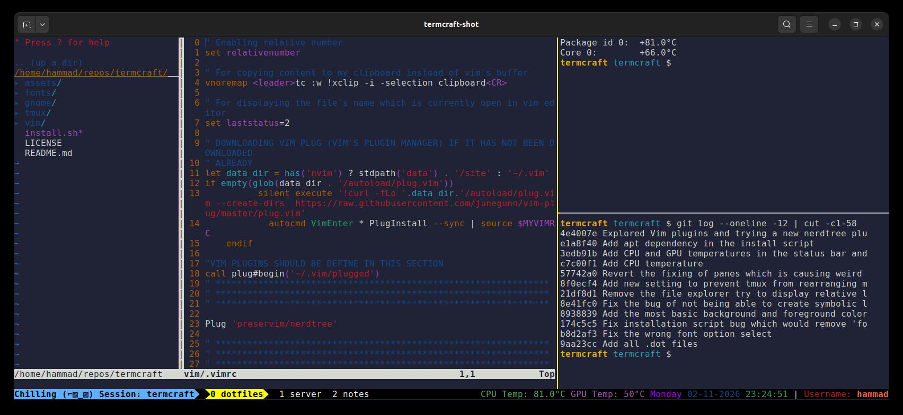
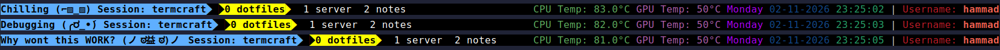
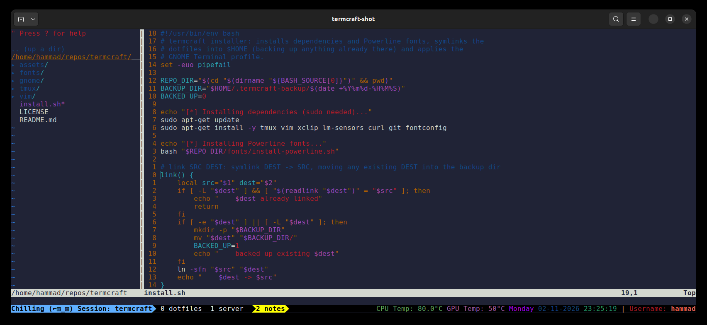

# termcraft

My terminal setup: **tmux**, **Vim** and **GNOME Terminal**, with Powerline fonts, a status bar that shows CPU/GPU temperatures, a clickable "mood" indicator, and a **Claude Code** mod that shows your usage as a weather forecast. One script installs all of it.



---

## Contents

- [What's inside](#whats-inside)
- [Requirements](#requirements)
- [Quick start](#quick-start)
- [What `install.sh` does](#what-installsh-does)
- [tmux](#tmux)
- [Vim](#vim)
- [GNOME Terminal profile](#gnome-terminal-profile)
- [Fonts](#fonts)
- [Claude Code: usage-weather mod](#claude-code-usage-weather-mod)
- [Customising](#customising)
- [Uninstalling](#uninstalling)
- [Troubleshooting](#troubleshooting)
- [Repository layout](#repository-layout)
- [License](#license)

---

## What's inside

| Component | File | What it does |
|---|---|---|
| tmux | [`tmux/.tmux.conf`](tmux/.tmux.conf) | Black-and-yellow Powerline-style status bar showing CPU/GPU temperatures, date, time and user. Easier pane splitting and switching, mouse support, vi copy mode that copies to the system clipboard, and a clickable mood indicator. |
| Vim | [`vim/.vimrc`](vim/.vimrc) | Relative line numbers, an always-visible status line, a "copy selection to clipboard" mapping, and [vim-plug](https://github.com/junegunn/vim-plug), which installs itself and [NERDTree](https://github.com/preservim/nerdtree) on first launch. |
| GNOME Terminal | [`gnome/apply-profile.sh`](gnome/apply-profile.sh) | Sets your default GNOME Terminal profile's font, colours, palette, cursor, scrollback and other settings using `gsettings`. |
| Fonts | [`fonts/install-powerline.sh`](fonts/install-powerline.sh) | Installs the [Powerline-patched fonts](https://github.com/powerline/fonts). These provide the arrow glyphs used in the status bar. |
| Claude Code | [`claude/usage-weather/`](claude/usage-weather) | A Claude Code mod that shows your context window and 5-hour / 7-day rate-limit usage as a weather forecast above the prompt. |
| Installer | [`install.sh`](install.sh) | Runs all of the above, with backups. |

## Requirements

- **Ubuntu / Debian**, or any distro with `apt`. Tested on Ubuntu 22.04.
- **GNOME Terminal**, for the profile step. With any other terminal, that step is skipped and everything else still works, but you have to choose a Powerline font in your terminal yourself.
- **An X11 session**, for clipboard integration (`xclip`). See [Troubleshooting](#troubleshooting) if you're on Wayland.
- `sudo`, to install packages.
- *Optional:* [**Claude Code**](https://claude.com/claude-code), for the usage-weather mod. Without it, that step is skipped.
- *Optional:* an **NVIDIA GPU** with `nvidia-smi`, for the GPU temperature. Without one, the status bar shows `N/A`.

## Quick start

```bash
git clone https://github.com/hammaad2002/termcraft.git
cd termcraft
./install.sh
```

Then:

1. Open a new GNOME Terminal window to see the new profile.
2. Start `tmux`. If tmux was already running, the installer has reloaded the config for you.
3. Run `vim` once. vim-plug downloads itself, installs NERDTree, and reloads.

## What `install.sh` does

You can run it from any directory, and running it again is safe.

1. **Installs packages** with apt: `tmux vim xclip lm-sensors curl git fontconfig`.
2. **Installs Powerline fonts** into `~/.local/share/fonts`. It clones the font repo into a temporary directory, which is deleted afterwards.
3. **Symlinks the dotfiles** into your home directory:
   - `~/.tmux.conf → <repo>/tmux/.tmux.conf`
   - `~/.vimrc → <repo>/vim/.vimrc`

   If a real file (or a different symlink) already exists there, it is **moved to `~/.termcraft-backup/<timestamp>/`** first. Nothing is deleted.
4. **Applies the GNOME Terminal profile** by running `gnome/apply-profile.sh`. It skips this if GNOME Terminal isn't installed.
5. **Installs the usage-weather Claude Code mod**, if the `claude` command is available and the mod isn't installed already. See [below](#claude-code-usage-weather-mod).
6. **Reloads tmux**, but only if a tmux server is already running.

Because the dotfiles are symlinks, a `git pull` in this repo updates your setup straight away. In tmux, press `prefix` + `r` to reload.

---

## tmux

### Keybindings

The prefix is tmux's default, **`Ctrl-b`**.

| Keys | Action |
|---|---|
| `prefix` `h` | Split the pane **side by side**, with a vertical divider (replaces `%`) |
| `prefix` `v` | Split the pane **top / bottom**, with a horizontal divider (replaces `"`) |
| `Alt` + `←` `→` `↑` `↓` | Move to the pane in that direction. No prefix needed. |
| `prefix` `r` | Reload `~/.tmux.conf` and show "Config reloaded..." |
| `prefix` `[` | Enter copy mode, which uses **vi keys** (move with `hjkl`, `Space` starts a selection) |
| `y` (in copy mode) | Copy the selection to the **system clipboard** (via `xclip`) and leave copy mode |
| Mouse | Click a pane to focus it, drag a border to resize, scroll to see history, click a window name to switch to it |
| Click the **left** status segment | Switch to the next mood (see below) |

### Status bar

The status bar has three parts, from left to right:

- **Left:** your current mood and the session name, on a light blue background.
- **Windows:** the active window has a yellow background with Powerline arrows; the others are plain white on black.
- **Right:** CPU temperature, GPU temperature, weekday, date (`DD-MM-YYYY`), time, and your username. It refreshes **every second**.

| Field | Where it comes from | When it shows `N/A` |
|---|---|---|
| CPU Temp | `sensors` (lm-sensors). Uses `Package id 0` on Intel, `Tctl` on AMD. | `lm-sensors` isn't set up, or your CPU reports a sensor with a different name |
| GPU Temp | `nvidia-smi` | There's no NVIDIA GPU or driver |

### Moods

Click the light blue segment at the left of the status bar to switch to the next mood:



`Chilling (⌐▨_▨)` → `Debugging (╭ರ_•́)` → `Why wont this WORK? (ノಠ益ಠ)ノ` → back to `Chilling`.

The mood is stored in the tmux user option `@emoji_face`. It applies to the whole tmux server and resets to "Chilling" when the server restarts.

### Other settings

- Pane borders: yellow for the active pane, grey for the others.
- `default-terminal` is set to `screen-256color`.
- `set-clipboard on`, so OSC 52 clipboard sequences are passed through to the terminal.

---

## Vim



### Settings

- `relativenumber`: line numbers are shown relative to the cursor, which makes jumps like `5j` easy.
- `laststatus=2`: the status line, showing the file name, is always visible.
- **vim-plug bootstrap:** the first time Vim starts, it downloads `plug.vim` into `~/.vim/autoload/` with `curl`, runs `:PlugInstall`, and reloads your vimrc. After that it only loads the plugins. (Under Neovim it uses Neovim's data directory instead.)
- **Plugins:** [NERDTree](https://github.com/preservim/nerdtree), a file tree.

### Mappings

The default `<leader>` is `\`.

| Mode | Keys | Action |
|---|---|---|
| Visual | `\tc` | Copy the selected **lines** to the system clipboard (`xclip`) |
| Normal | `\n` | Move focus to the NERDTree window |
| Normal | `Ctrl-n` | Open NERDTree |
| Normal | `Ctrl-t` | Toggle NERDTree |
| Normal | `Ctrl-f` | Reveal the current file in NERDTree |

> **Heads up:** `Ctrl-f` and `Ctrl-t` replace Vim's built-in *page down* and *jump back from tag*. Use `PageDown` or `Ctrl-d` to scroll instead. If you'd rather keep Vim's defaults, change these mappings in `vim/.vimrc`.

---

## GNOME Terminal profile

> ⚠️ **This changes your _default_ GNOME Terminal profile in place and renames it to "NoobProfile".** It does not create a new profile. To undo it, see [Uninstalling](#uninstalling).

What [`gnome/apply-profile.sh`](gnome/apply-profile.sh) sets:

| Area | Setting |
|---|---|
| Font | `DejaVu Sans Mono for Powerline 12`, instead of the system font |
| Colours | Background `#202336`, foreground `#D3D7CF`; theme colours turned off |
| Palette | A custom 16-colour palette; bold text is shown in bright colours |
| Cursor | I-beam that blinks; text blinking always allowed |
| Size | Opens at 80 × 24 |
| Scrolling | **Unlimited scrollback**, no scrollbar, scroll on keystroke but not on output |
| Behaviour | No terminal bell, not a login shell, new terminals open as windows, new tabs go last, the window closes when the shell exits |
| Global | Dark theme variant; menu mnemonics off; F10 menu shortcut and keyboard shortcuts on |
| Encoding | UTF-8, ambiguous-width CJK characters treated as narrow |

To apply it again without running the full installer:

```bash
bash gnome/apply-profile.sh
```

---

## Fonts

`fonts/install-powerline.sh` clones [powerline/fonts](https://github.com/powerline/fonts) and runs its installer. This puts **every** Powerline-patched font into `~/.local/share/fonts` and refreshes the font cache. The GNOME profile uses *DejaVu Sans Mono for Powerline*. Pick any other "… for Powerline" font in GNOME Terminal's preferences if you prefer.

---

## Claude Code: usage-weather mod

A [Claude Code](https://claude.com/claude-code) mod that adds a dim line above the prompt showing how much of your context window and rate limits you've used, as a weather forecast:

```
● Context: ☀️ Sunny 12%  │  5h: ⛅ Partly cloudy 41% clears in 2h13m  │  7d: ☁️ Overcast 63% clears in 74h5m
```

| Usage | Forecast |
|---|---|
| under 30% | ☀️ Sunny |
| 30–54% | ⛅ Partly cloudy |
| 55–74% | ☁️ Overcast |
| 75–89% | 🌧️ Rain |
| 90% and up | ⛈️ Storm |

- **Context** is how full the current session's context window is.
- **5h** and **7d** are your rolling 5-hour and 7-day rate limits. "clears in …" counts down, second by second, to when that window resets.
- A leading **●** means the figures are *live*. Every 10 seconds the mod asks Anthropic's usage endpoint for your account-wide usage, which includes your other sessions. Until the first answer arrives (or if the endpoint never answers), it shows the figures from this session's own last response instead, without the dot. Once it has a live answer, a failed poll just keeps the last live figures.

> The live figures come from `https://api.anthropic.com/api/oauth/usage`, an **undocumented** endpoint, using your Claude Code login. It may change or disappear without notice. If it does, the mod quietly falls back to this session's own figures.

### Installing it

`install.sh` does this for you. To do it by hand:

```bash
claude plugin marketplace add ./claude        # this repo's claude/ folder is a plugin marketplace called "termcraft"
claude plugin install usage-weather@termcraft
```

Then start a new Claude Code session. If you use several Claude Code config directories, run these commands once for each of them with `CLAUDE_CONFIG_DIR=<dir>` set.

### Files

| File | What it is |
|---|---|
| [`claude/.claude-plugin/marketplace.json`](claude/.claude-plugin/marketplace.json) | Makes `claude/` a marketplace that lists the mod |
| [`claude/usage-weather/.claude-plugin/plugin.json`](claude/usage-weather/.claude-plugin/plugin.json) | The mod's manifest (name, version, description) |
| [`claude/usage-weather/hooks/register.tsx`](claude/usage-weather/hooks/register.tsx) | All of the logic: reads usage, polls the endpoint, draws the forecast line |
| [`claude/usage-weather/types/index.d.ts`](claude/usage-weather/types/index.d.ts) | Types for the mod's saved reading |

`tsconfig.json` extends type definitions that Claude Code generates into `.claude-plugin/types/` while you develop a mod. Those are gitignored, so type-checking only works after Claude Code has generated them.

After editing the mod, bump `version` in `plugin.json`, then run `claude plugin marketplace update termcraft` and `claude plugin install usage-weather@termcraft`, and start a new session.

---

## Customising

Your dotfiles are symlinks into this repo, so edit the files here and reload.

**Add or change a mood.** Edit the `MouseDown1StatusLeft` binding in `tmux/.tmux.conf`. Each `if`/`elif` branch moves from one mood to the next. Also update the starting mood in `set -g @emoji_face "..."`. Keep `status-left-length` (60) large enough for your longest mood plus the session name.

**Change the colours.**
- Accent yellow: `#ffff00` (active window and active pane border).
- Mood background: `#42b3f5`.
- Terminal background: `#202336` in `gnome/apply-profile.sh`.

**Add a Vim plugin.** Add a `Plug 'author/repo'` line between `plug#begin` and `plug#end` in `vim/.vimrc`, then run `:source $MYVIMRC | PlugInstall` inside Vim.

**Change the tmux prefix.** For example, to use `Ctrl-a`:

```tmux
unbind C-b
set -g prefix C-a
bind C-a send-prefix
```

---

## Uninstalling

```bash
# 1. Remove the symlinks
rm ~/.tmux.conf ~/.vimrc

# 2. Restore your old dotfiles, if the installer backed any up
ls ~/.termcraft-backup/                       # pick the timestamp you want
cp -a ~/.termcraft-backup/<timestamp>/. ~/

# 3. Reset the GNOME Terminal profile to GNOME's defaults
PROFILE_ID=$(gsettings get org.gnome.Terminal.ProfilesList default | tr -d \')
dconf reset -f "/org/gnome/terminal/legacy/profiles:/:$PROFILE_ID/"

# 4. Remove the Claude Code mod
claude plugin uninstall usage-weather@termcraft
claude plugin marketplace remove termcraft

# 5. (Optional) Remove the vim-plug files and the fonts
rm -rf ~/.vim/plugged ~/.vim/autoload/plug.vim
rm -f ~/.local/share/fonts/*Powerline* && fc-cache -f
```

Step 5's font command removes *all* fonts with "Powerline" in their name, including any you installed some other way.

---

## Troubleshooting

**The status bar shows boxes or `?` instead of arrows.**
Your terminal isn't using a Powerline font. Check that the fonts are installed with `fc-list | grep -i powerline`, then select a "… for Powerline" font in your terminal's preferences.

**CPU Temp shows `N/A`.**
Run `sensors`. If it prints nothing useful, run `sudo sensors-detect` and accept the defaults. If your CPU's sensor isn't called `Package id 0` (Intel) or `Tctl` (AMD), edit the `awk` pattern in `status-right` to match your sensor's label.

**GPU Temp shows `N/A`.**
This is expected without an NVIDIA GPU. If you have one, check that `nvidia-smi` works on its own.

**Copying with `y` in tmux or `\tc` in Vim doesn't reach the clipboard.**
Both use `xclip`, which needs X11. On Wayland, install `wl-clipboard` and replace `xclip -i -sel clipboard` / `xclip -i -selection clipboard` with `wl-copy`.

**`tmux source` says "no server running".**
That's harmless. It just means tmux wasn't running; the config is used the next time you start `tmux`.

**Vim shows errors about `plug#begin` the first time it starts.**
The vim-plug download needs `curl` and internet access. Check those, then restart Vim.

**My pane sizes change when I resize the terminal.**
That's how tmux normally behaves. `window-size manual` stops it, but it caused other problems here, so it's left out.

---

## Repository layout

```
termcraft/
├── install.sh                 # one-shot installer (deps, fonts, symlinks, GNOME profile)
├── fonts/
│   └── install-powerline.sh   # installs the Powerline-patched fonts
├── gnome/
│   └── apply-profile.sh       # sets the default GNOME Terminal profile via gsettings
├── tmux/
│   └── .tmux.conf             # → ~/.tmux.conf
├── vim/
│   └── .vimrc                 # → ~/.vimrc
├── claude/                    # Claude Code plugin marketplace ("termcraft")
│   └── usage-weather/         # the usage-weather mod
├── assets/                    # screenshots used in this README
└── LICENSE
```

## License

[MIT](LICENSE) © 2025 Hammad Ali Khan
